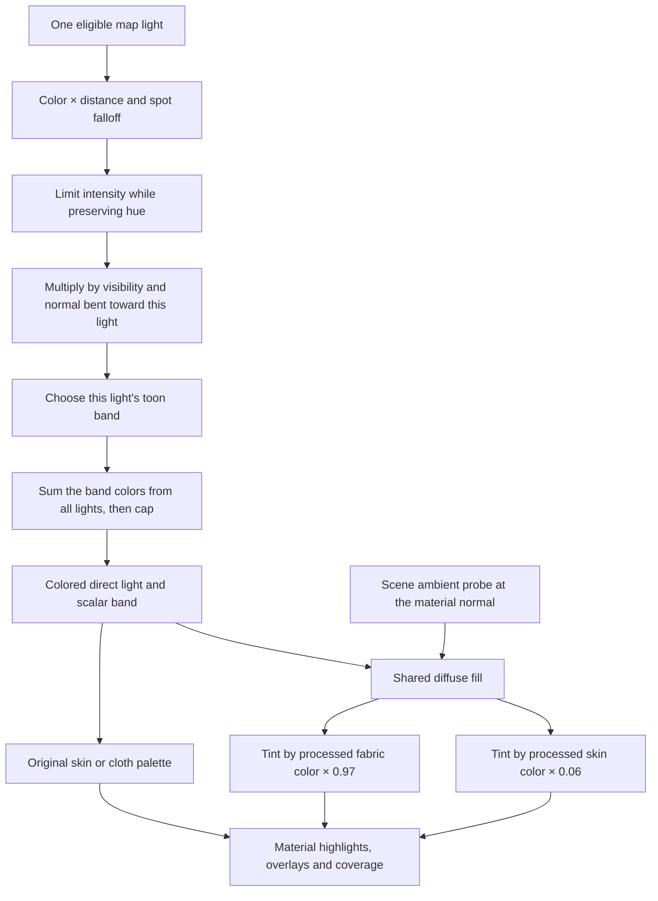

# Character lighting source

Start with the [Slang sources and build instructions](README.md). The bundle builder compiles toon bands and diffuse fill from [SceneLighting.slang](Lighting/SceneLighting.slang) into the skin and fabric keyword variants. [SceneToonLighting.hlsl](hlsl/SceneToonLighting.hlsl) is a historical reference for the November 18 arithmetic. [PreviousMaterialFill.hlsl](hlsl/PreviousMaterialFill.hlsl) reconstructs the previous fill at the same two points in the material pipeline.



The two fill multipliers calibrate different starting points. The previous fabric already used the full common fill. Skin already had its own lit palette and had zero supplemental fill. A multiplier of 0.06 introduces a small contribution there. Final brightness can still differ with pigment, normal maps, gloss and the original material composition.

The visibility input comes from the game's punctual shadow lookup and distance fade. The authored directional list supplies color and direction with visibility equal to one. Each light bends the original surface normal 25% toward its own direction. The resulting normalized dot product drives its diffuse band. An orbit around a stationary subject therefore leaves that input fixed. Specular reflections still use the view direction.

## Full program listings

The local [source pack](../../artifacts/npr/normal-bend/character-shader-sources.zip) includes the handwritten lighting source and 16 translated HLSL listings. Each material has a stock game version, the November 18 version, the camera-bent calibrated version and the normal-bent version. The manifests record the Unity slot, keyword set and DXBC digest. These listings cover the same representative regular Forward+ pixel variant in all four builds. Local names and packed registers reflect the compiler output; the original Unity project source is unavailable.

To regenerate a listing from local game assets, run `export_material_programs.py OUTPUT --source INPUT --vkd3d PATH --spirv-cross PATH`. Omit `--source` for the stock serialized file. The exporter also works with just the output and input paths to extract DXBC for D3D disassembly. The inspection path uses vkd3d's DXBC-to-SPIR-V translator and SPIRV-Cross's HLSL backend. All 16 listings compiled with the Windows SDK DXC at `ps_6_0`. The running game loads SM5 programs with its original Unity signatures and resource bindings. The bundle builder uses FXC on the named entry points and binds their arithmetic into those programs.

## Scene-lit hair and face shadow trials

[HairLighting.slang](Materials/Hair/HairLighting.slang) contains the reflection shape, diffuse light cap and reflection tint. The painted version samples the artist's highlight texture along the strand at a coordinate derived from each light's half-vector. The original material contributes a weaker painted stripe. Each eligible punctual source supplies its own distance falloff, spot falloff and shadow visibility. Authored map directionals supply color and direction with unit visibility. Both hair color passes use this calculation. The base pass keeps its opaque dither coverage and the forward overlay keeps its material alpha. The hair outline uses the original shader.

[ShadowFiltering.slang](Lighting/ShadowFiltering.slang) samples punctual shadow visibility with a nine-tap tent. The face chooses its toon band from the unoccluded incident light and weights the result by the filtered visibility. The night beach comparison showed that disabling character casting removed the broad contour, and hair alone reproduced it. Hiding the face shadow proxy alone made little difference. The additional-light atlas was 8192 × 4096 D16. D32 softened a secondary contour. Applying visibility after the band made the larger difference in the tested pose. The new loader exposes an opt-in `HigherShadowDepthPrecision` setting for the additional-light atlas.

To reproduce the live painted trial from the normal-bend default, run these commands from the repository root.

```powershell
python AL_NPR/tools/build_hair_reflection.py artifacts/npr/default-build/al-skin-lighting.unity3d artifacts/npr/normal-bend/balanced.unity3d --style painted
python AL_NPR/tools/build_face_shadow_trial.py artifacts/npr/normal-bend/balanced.unity3d artifacts/npr/normal-bend/balanced-face.unity3d
python AL_NPR/tools/validate_toon_bundle.py artifacts/npr/normal-bend/balanced-face.unity3d
```

The hair builder also supports `--style gloss`, `--style ribbon` and `--specular-only` for isolating reflections. The new lighting expressions run in the regular Forward+ programs, including conventional instancing. The base pass uses the forward color program family with its own coverage. DOTS appearance and custom character cards have not been visually tested. The trial bundle leaves the skin body, fabric, hair depth and shadow caster programs intact.

The [hair comparison](../../artifacts/npr/normal-bend/hair-final.jpg) includes the isolated painted reflection under two colored lamps. The [face comparison](../../artifacts/npr/normal-bend/face-comparison.jpg) holds the camera, pose and hair shader fixed. In two eight-second samples per condition at 2560 × 1440, the stock-hair baseline recorded median GPU frame times of 6.39 and 6.38 ms. Painted hair plus the face filter recorded 6.30 and 6.23 ms at D16, and 6.01 and 6.30 ms at D32. These are whole-frame timings for the held beach camera.
