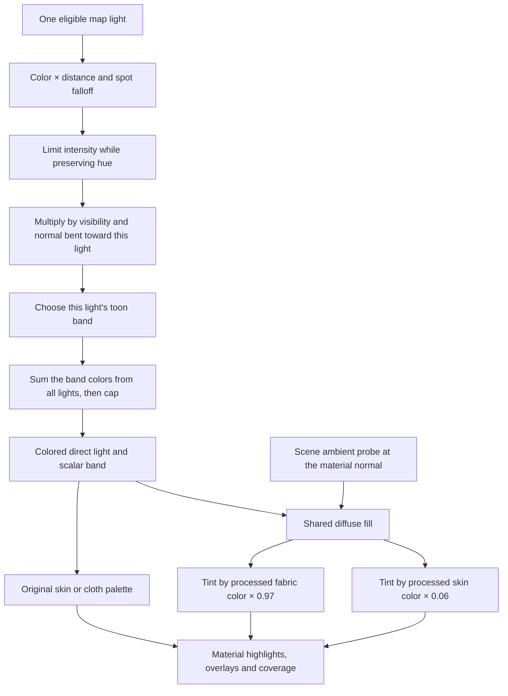

# Character lighting source

[SceneToonLighting.hlsl](SceneToonLighting.hlsl) is the short version to read first. FXC compiles `BandFacing`, `PerLightBand`, `SkinFill`, and `FabricFill` from this file into the skin head, skin body, opaque cloth and alpha-clipped cloth shader programs. The other functions describe the surrounding ALU instructions retained from the November 18 build. [PreviousMaterialFill.hlsl](PreviousMaterialFill.hlsl) reconstructs the previous fill at the same two points in the material pipeline.

The two fill multipliers calibrate different starting points. The previous fabric already used the full common fill. Skin already had its own lit palette and had zero supplemental fill. A multiplier of 0.06 introduces a small contribution there. Final brightness can still differ with pigment, normal maps, gloss and the original material composition.

The visibility input comes from the game's punctual shadow lookup and distance fade. The authored directional list supplies color and direction with visibility equal to one. Each light bends the original surface normal 25% toward its own direction. The resulting normalized dot product drives its diffuse band. An orbit around a stationary subject therefore leaves that input fixed. Specular reflections still use the view direction.

## Full program listings

The local [source pack](../../artifacts/npr/normal-bend/character-shader-sources.zip) includes the handwritten lighting source and 16 translated HLSL listings. Each material has a stock game version, the November 18 version, the camera-bent calibrated version and the normal-bent version. The manifests record the Unity slot, keyword set and DXBC digest. These listings cover the same representative regular Forward+ pixel variant in all four builds. Local names and packed registers reflect the compiler output; the original Unity project source is unavailable.

To regenerate a listing from local game assets, run `export_material_programs.py OUTPUT --source INPUT --vkd3d PATH --spirv-cross PATH`. Omit `--source` for the stock serialized file. The exporter also works with just the output and input paths to extract DXBC for D3D disassembly. The inspection path uses vkd3d's DXBC-to-SPIR-V translator and SPIRV-Cross's HLSL backend. All 16 listings compiled with the Windows SDK DXC at `ps_6_0`. The running game loads SM5 programs with its original Unity signatures and resource bindings. The bundle builder uses FXC on the named entry points and binds their arithmetic into those programs.
